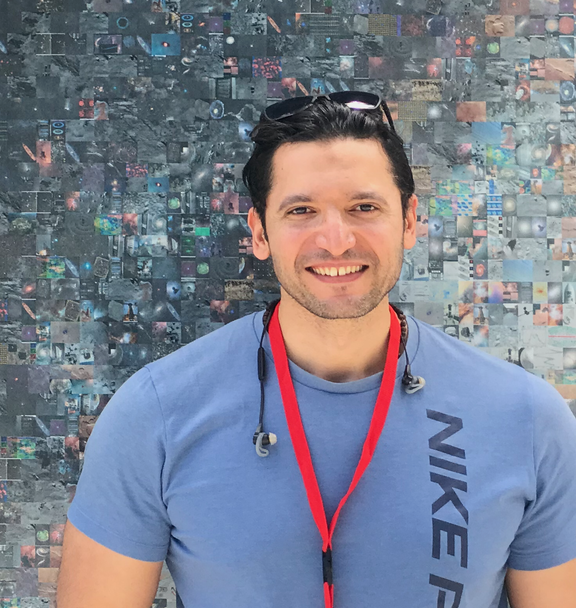

  <section class="ah-hero" aria-labelledby="ah-hero-title">
    

      
 National Solar Observatory · Boulder, Colorado

      
SOLAR PHYSICS &nbsp; / &nbsp; HELIOSEISMOLOGY &nbsp; / &nbsp; SPACE WEATHER

      <h1 id="ah-hero-title">Dr. Amr Hamada</h1>
      
Associate Research Scientist

      <h2>Exploring the Sun <em>beyond the visible disk.</em></h2>
      
I investigate the Sun's far-side magnetic activity using helioseismology, Solar Orbiter observations, uncertainty quantification, and scientific machine learning—developing methods and open datasets for a more complete view of the Sun.

      

        <a class="ah-button ah-button-primary" href="/research/">Explore my research ↗</a>
        <a class="ah-button ah-button-outline" href="/publications/">Publications →</a>
      

      

        <a href="https://scholar.google.com/citations?user=R02-FAsAAAAJ" rel="noopener noreferrer" target="_blank">Google Scholar ↗</a>
        <a href="https://orcid.org/0000-0002-8900-8011" rel="noopener noreferrer" target="_blank">ORCID ↗</a>
        <a href="https://github.com/Amr1001Hamada" rel="noopener noreferrer" target="_blank">GitHub ↗</a>
        <a href="/cv/">Academic CV ↗</a>
      

    

    

      

        
        
 SEEING THE UNSEEN <small>GONG &nbsp; × &nbsp; Solar Orbiter / PHI</small>

      

      

        
        
<strong>Amr Hamada, Ph.D.</strong>Solar physicist · NSO

      

      
Research image: <a href="https://doi.org/10.1038/s41598-026-42917-x" target="_blank" rel="noopener noreferrer">Hamada et al., <i>Scientific Reports</i> (2026)</a>, CC BY 4.0.

    

  </section>

  <section class="ah-pillars" aria-label="Research focus areas">
    
01<strong>Far-side solar magnetism</strong>Magnetic-field and polarity inference

    
02<strong>Machine learning</strong>Active-region detection and analysis

    
03<strong>Open solar data</strong>Synoptic maps and uncertainty products

  </section>

  <section class="ah-section ah-work" aria-labelledby="ah-work-heading">
    

      

        
RESEARCH HIGHLIGHTS &nbsp; — &nbsp; SELECTED WORK

        <h2 id="ah-work-heading">Turning observations into <em>solar insight.</em></h2>
      

      <a class="ah-text-link" href="/research/">All research directions ↗</a>
    

    

      <article class="ah-work-card">
        <a class="ah-card-visual ah-visual-purple" href="https://doi.org/10.1038/s41598-026-42917-x" target="_blank" rel="noopener noreferrer" aria-label="Read polarity-resolved far-side magnetograms paper">
          
          PEER-REVIEWED · 2026
        </a>
        

          
MAGNETIC FIELD RECONSTRUCTION

          <h3>Polarity-resolved far-side magnetograms</h3>
          
Reconstructing the large-scale magnetic configuration of hidden active regions from GONG helioseismic signatures and validating against SO/PHI.

          <a href="https://doi.org/10.1038/s41598-026-42917-x" rel="noopener noreferrer" target="_blank">Scientific Reports ↗</a>
        

      </article>
      <article class="ah-work-card">
        <a class="ah-card-visual ah-visual-green" href="https://doi.org/10.3847/1538-4365/add893" target="_blank" rel="noopener noreferrer" aria-label="Read FASTARR paper">
          
          PUBLISHED · 2025
        </a>
        

          
AI FOR SOLAR OBSERVATIONS

          <h3>FASTARR — recognizing far-side active regions</h3>
          
A U-Net–based framework for identifying candidate active regions on the Sun's far side in helioseismic maps.

          <a href="https://doi.org/10.3847/1538-4365/add893" rel="noopener noreferrer" target="_blank">ApJS paper ↗</a>
        

      </article>
      <article class="ah-work-card">
        <a class="ah-card-visual ah-visual-blue" href="/datasets/" aria-label="Explore solar datasets">
          
          OPEN SCIENCE
        </a>
        

          
OBSERVATIONS & REUSABLE DATA

          <h3>Data products for solar research</h3>
          
Published far-side datasets and synoptic solar maps, with ongoing quality-assessed EUV/UV archive development.

          <a href="/datasets/">Explore datasets ↗</a>
        

      </article>
    

    
Featured research figures: <a href="https://doi.org/10.1038/s41598-026-42917-x" target="_blank" rel="noopener noreferrer">Hamada et al. (2026), <i>Scientific Reports</i></a>, Figures 3, 9, and 10; CC BY 4.0. The FASTARR card illustrates its use in the 2026 study.

  </section>

  <section class="ah-section ah-latest" aria-labelledby="ah-latest-heading">
    

      

        
SELECTED PUBLICATIONS

        <h2 id="ah-latest-heading">Research in print.</h2>
      

      <a class="ah-text-link" href="/publications/">Complete publication list ↗</a>
    

    

      <a href="https://doi.org/10.1038/s41598-026-42917-x" target="_blank" rel="noopener noreferrer">2026<strong>Polarity-resolved far-side magnetograms based on helioseismic measurements</strong><small>Hamada et al. · Scientific Reports 16, 13110</small>↗</a>
      <a href="https://doi.org/10.3847/1538-4365/add893" target="_blank" rel="noopener noreferrer">2025<strong>FArSide Trained Active Region Recognition (FASTARR): A Machine Learning Approach</strong><small>Hamada et al. · The Astrophysical Journal Supplement Series 278, 53</small>↗</a>
      <a href="https://doi.org/10.3847/1538-4357/ad8636" target="_blank" rel="noopener noreferrer">2024<strong>Far-side active regions based on helioseismic and EUV measurements</strong><small>Hamada et al. · The Astrophysical Journal</small>↗</a>
    

  </section>

  <section class="ah-section ah-beyond" aria-labelledby="ah-beyond-heading">
    

      
BEYOND THE RESEARCH PAPERS

      <h2 id="ah-beyond-heading">Building knowledge. <em>Sharing discovery.</em></h2>
      
Scientific progress also depends on mentoring, open resources, and bringing space science to new communities.

    

    

      
✦<h3>Teaching & mentoring</h3>
Graduate teaching, curriculum development, and supervision of undergraduate and graduate research in heliophysics and scientific computing.
<a href="/teaching/">Teaching & supervision →</a>

      
◎<h3>Arabic science engagement</h3>
Founder and organizer of the Arab Forum for Space Weather Science, supporting collaboration and Arabic-language scientific outreach.
<a href="/outreach/">Outreach initiatives →</a>

    

  </section>

  <section class="ah-arabic" dir="rtl" lang="ar" aria-labelledby="ah-arabic-title">
    

      
نبذة بالعربية

      <h2 id="ah-arabic-title">أبحاث تكشف ما لا نراه من الشمس</h2>
      
د. عمرو حمادة باحث علمي مشارك في المرصد الوطني الشمسي بالولايات المتحدة. تتركز أبحاثه على دراسة الجانب البعيد من الشمس، واستنتاج توزيعات المجال المغناطيسي وأقطابه اعتمادًا على القياسات الزلزالية الشمسية، وتطوير تطبيقات تعلّم الآلة والبيانات العلمية لخدمة أبحاث فيزياء الشمس والطقس الفضائي.

    

    <a href="/research/">تعرّف على المشروعات البحثية ←</a>
  </section>

  <section class="ah-contact" aria-label="Contact">
    
OPEN TO SCIENTIFIC COLLABORATION<h2>Let's advance solar research together.</h2>
Research collaborations · Student mentoring · Scientific exchange

    <a class="ah-button ah-button-primary" href="mailto:ahamada@nso.edu">Get in touch ↗</a>
  </section>

