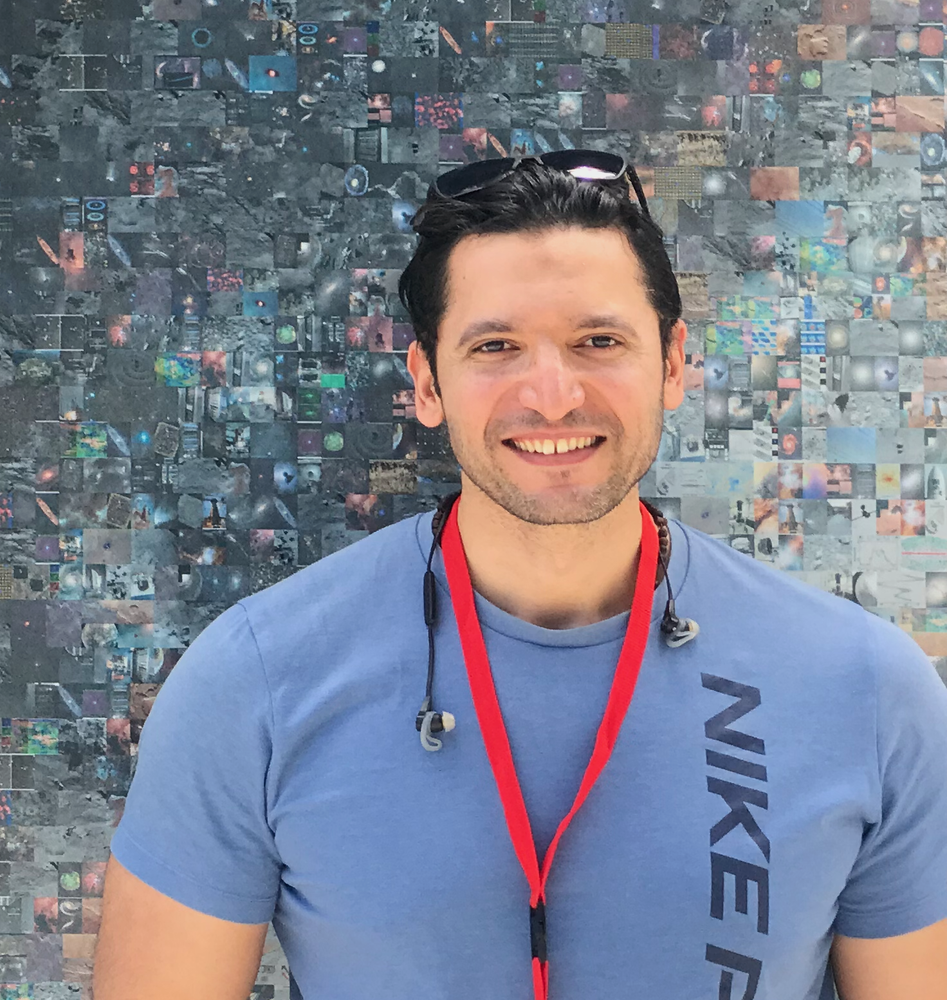

  <section class="ah-hero" aria-labelledby="arabic-hero-title">
    

      
 المرصد الوطني الشمسي · بولدر، كولورادو

      
فيزياء الشمس &nbsp; / &nbsp; علم زلازل الشمس &nbsp; / &nbsp; الطقس الفضائي

      <h1 id="arabic-hero-title">د. عمرو حمادة</h1>
      
باحث علمي مشارك Associate Research Scientist

      <h2>نحو رؤية أشمل للشمس... <em>تتجاوز ما نراه من الأرض.</em></h2>
      
أدرس النشاط الشمسي على الجانب البعيد من الشمس باستخدام القياسات الزلزالية الشمسية، ورصد المركبات الفضائية، وتعلّم الآلة. وتركّز أبحاثي على استنتاج توزيع المجال المغناطيسي وأقطابه، وقياس عدم اليقين في النتائج، وتطوير بيانات علمية قابلة للاستخدام وإعادة التحليل.

      

        <a class="ah-button ah-button-primary" href="/ar/research/">استكشف أبحاثي ←</a>
        <a class="ah-button ah-button-outline" href="/ar/publications/">المنشورات العلمية ←</a>
      

      

        <a href="https://scholar.google.com/citations?user=R02-FAsAAAAJ" target="_blank" rel="noopener noreferrer" lang="en">Google Scholar ↗</a>
        <a href="https://orcid.org/0000-0002-8900-8011" target="_blank" rel="noopener noreferrer" lang="en">ORCID ↗</a>
        <a href="https://github.com/Amr1001Hamada" target="_blank" rel="noopener noreferrer" lang="en">GitHub ↗</a>
        <a href="/ar/cv/">السيرة الأكاديمية ←</a>
      

    

    

      

        
        
 رصد الجانب الذي لا نراه <small dir="ltr">GONG × Solar Orbiter/PHI</small>

      

      

        
        
<strong>د. عمرو حمادة</strong>فيزياء الشمس · <bdi>NSO</bdi>

      

      
حقوق الأشكال والبيانات: NSF/NSO/GONG وفريق Solar Orbiter/PHI لدى وكالتي الفضاء الأوروبية والأمريكية. <a href="https://phys.org/news/2026-04-scientists-hidden-magnetism-sun-side.html" target="_blank" rel="noopener noreferrer">المصدر العلمي والتعليق الأصلي</a>.

    

  </section>

  <section class="ah-pillars" aria-label="المجالات البحثية الرئيسية">
    
01<strong>مغناطيسية الجانب البعيد</strong>استنتاج الشدة والقطبية المغناطيسية

    
02<strong>تعلّم الآلة في رصد الشمس</strong>الكشف الآلي عن المناطق النشطة

    
03<strong>البيانات الشمسية المفتوحة</strong>خرائط شمولية ومنتجات عدم اليقين

  </section>

  <section class="ah-section ah-work" aria-labelledby="ar-highlights-title">
    

      

مختارات من الأبحاث العلمية
<h2 id="ar-highlights-title">من الإشارات المرصودة إلى <em>فهم أعمق للشمس</em></h2>

      <a class="ah-text-link" href="/ar/research/">جميع الاتجاهات البحثية ←</a>
    

    

      <article class="ah-work-card">
        <a class="ah-card-visual ah-visual-purple" href="https://doi.org/10.1038/s41598-026-42917-x" target="_blank" rel="noopener noreferrer" aria-label="فتح بحث الخرائط المغناطيسية للجانب البعيد">
          
          بحث محكّم · 2026
        </a>
        

          
استنتاج المجالات المغناطيسية

          <h3>خرائط مغناطيسية لقطبيات المناطق النشطة على الجانب البعيد</h3>
          
منهجية تستفيد من قياسات الاهتزازات الشمسية لاستنتاج التوزيع المغناطيسي ثنائي القطبية، ومقارنة النتائج بقياسات <bdi>Solar Orbiter/PHI</bdi>.

          <a href="https://doi.org/10.1038/s41598-026-42917-x" target="_blank" rel="noopener noreferrer">قراءة البحث في Scientific Reports ↗</a>
        

      </article>
      <article class="ah-work-card">
        <a class="ah-card-visual ah-visual-green" href="https://doi.org/10.3847/1538-4365/add893" target="_blank" rel="noopener noreferrer" aria-label="فتح البحث المنشور عن FASTARR">
          
          بحث محكّم · 2025
        </a>
        

          
الذكاء الاصطناعي في الفيزياء الشمسية

          <h3>نموذج <bdi>FASTARR</bdi> للتعرّف على المناطق النشطة</h3>
          
إطار قائم على التعلّم العميق لتحديد المناطق النشطة المحتملة على الجانب البعيد، مما يتيح متابعتها وتحليل تغيراتها بصورة منهجية.

          <a href="https://doi.org/10.3847/1538-4365/add893" target="_blank" rel="noopener noreferrer">قراءة بحث ApJS ↗</a>
        

      </article>
      <article class="ah-work-card">
        <a class="ah-card-visual ah-visual-blue" href="/ar/datasets/" aria-label="الانتقال إلى قواعد البيانات العلمية">
          
          بيانات وأدوات بحثية
        </a>
        

          
العلم المفتوح وقابلية إعادة الاستخدام

          <h3>أرشيفات وخرائط شمسية للباحثين</h3>
          
منتجات رصدية من <bdi>GONG</bdi> و<bdi>SDO/AIA</bdi> وغيرها، تشمل مجموعات منشورة وخرائط قيد الإعداد مع توثيق عدم اليقين.

          <a href="/ar/datasets/">استكشاف مجموعات البيانات ←</a>
        

      </article>
    

    
مصدر الأشكال العلمية في البطاقات: <a href="https://doi.org/10.1038/s41598-026-42917-x" target="_blank" rel="noopener noreferrer">Hamada et al., Scientific Reports (2026)</a>، الأشكال 3 و9 و10، بترخيص CC BY 4.0. توضح بطاقة <bdi>FASTARR</bdi> أحد تطبيقاته الواردة في دراسة 2026.

  </section>

  <section class="ah-section ah-latest" aria-labelledby="ar-impact-title">
    

      

الأثر والإسهام العلمي
<h2 id="ar-impact-title">ماذا تضيف هذه الأبحاث؟</h2>

      <a class="ah-text-link" href="/ar/research/">تفاصيل المشروعات ←</a>
    

    

      
01<h3>توسيع الرؤية الشمسية</h3>
تعزيز المعلومات عن المناطق النشطة غير المرئية مباشرة من الأرض، بالاستفادة من القياسات الزلزالية الشمسية.

      
02<h3>توصيف أدق للنشاط المغناطيسي</h3>
إضافة معلومات عن الشدة والقطبية إلى مجرد اكتشاف وجود منطقة نشطة، مع توضيح حدود الاستدلال وعدم اليقين.

      
03<h3>تيسير إعادة إنتاج النتائج</h3>
إعداد مجموعات بيانات وأدوات تحليل تدعم المقارنة المستقلة وتطوير دراسات جديدة في الطقس الفضائي.

    

  </section>

  <section class="ah-section ah-latest" aria-labelledby="ar-publications-title">
    

      

منشورات مختارة
<h2 id="ar-publications-title">نتائج منشورة في دوريات علمية محكّمة</h2>

      <a class="ah-text-link" href="/ar/publications/">جميع المنشورات ←</a>
    

    

      <a href="https://doi.org/10.1038/s41598-026-42917-x" target="_blank" rel="noopener noreferrer">2026<strong>الخرائط المغناطيسية المستنتجة للجانب البعيد من الشمس والمميّزة للقطبية</strong><small>Polarity-resolved far-side magnetograms based on helioseismic measurements · Scientific Reports</small>↗</a>
      <a href="https://doi.org/10.3847/1538-4365/add893" target="_blank" rel="noopener noreferrer">2025<strong>نموذج <bdi>FASTARR</bdi> للكشف عن المناطق النشطة في الجانب البعيد باستخدام تعلّم الآلة</strong><small>FArSide Trained Active Region Recognition · The Astrophysical Journal Supplement Series</small>↗</a>
      <a href="https://doi.org/10.3847/1538-4357/ad8636" target="_blank" rel="noopener noreferrer">2024<strong>مجموعة بيانات للمناطق النشطة في الجانب البعيد بالاعتماد على القياسات الزلزالية والأشعة فوق البنفسجية القصوى</strong><small lang="en">The Astrophysical Journal</small>↗</a>
    

  </section>

  <section class="ah-section ah-beyond" aria-labelledby="ar-education-title">
    

      
التدريس والتعاون العلمي

      <h2 id="ar-education-title">البحث، <em>والتعليم، وبناء المجتمع العلمي</em></h2>
      
أهتم بتحويل الخبرة البحثية إلى أدوات تعلّم وتدريب، وبإتاحة فرص إشراف وتعاون للطلاب والباحثين في علوم الشمس والفضاء.

    

    

      
✦<h3>التدريس والإشراف</h3>
تدريس الفيزياء، وتطوير المقررات، والإشراف على أبحاث طلبة البكالوريوس والماجستير والدكتوراه، بما فيها أبحاث <bdi>REU</bdi>.
<a href="/ar/teaching/">الخبرات التدريسية والإشرافية ←</a>

      
◎<h3>التواصل العلمي بالعربية</h3>
تأسيس المنتدى العربي لعلوم الطقس الفضائي، والمشاركة في نشر العلوم، والعمل على كتاب «الكسوف» الذي ما زال في مرحلة الإعداد.
<a href="/ar/outreach/">المبادرات والتواصل العلمي ←</a>

    

  </section>

  <section class="ah-contact" aria-label="التواصل والتعاون">
    
فرص التعاون الأكاديمي والبحثي<h2>هل لديك فكرة بحثية نعمل عليها معًا؟</h2>
التعاون العلمي · الإشراف الأكاديمي · تبادل الخبرات العلمية

    <a class="ah-button ah-button-primary" href="mailto:ahamada@nso.edu">تواصل معي ←</a>
  </section>

